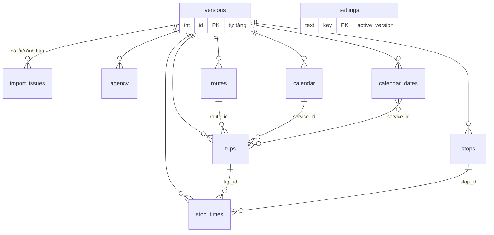

# Cơ sở dữ liệu

SQLite 3 qua PDO. Lược đồ tạo tự động khi kết nối (`src/Db.php`, `Db::migrate`); bản tham chiếu độc lập ở [`db/schema.sql`](../db/schema.sql).
Tệp CSDL mặc định: `data/gtfs.sqlite` (đổi bằng biến `GTFS_DB`; `.gitignore` đã loại khỏi Git).

## Nguyên tắc
- **Mỗi phiên bản lịch là một dòng trong `versions`**; mọi bảng GTFS đều có `version_id` nên hai bản không lẫn dữ liệu.
- Khóa chính các bảng GTFS đều gồm `version_id` (ví dụ `(version_id, trip_id)`), nên cùng `trip_id` ở hai bản là hai dòng khác nhau.
- `ON DELETE CASCADE` từ `versions`: xóa bản chỉ xóa dữ liệu của bản đó. Bản đang dùng không được xóa (kiểm tra trong `Versions::delete`).
- Bản nhập lỗi chỉ có dòng trong `versions` (`status = 'invalid'`) và `import_issues`; **không có dữ liệu lịch**.
- Bản đang dùng lưu ở `settings` (`key = 'active_version'`); đổi bản là một giao dịch.
- Giờ lưu hai dạng: `*_secs` (số giây từ nửa đêm ngày hoạt động, có thể ≥ 86400, ví dụ `25:10:00` = 90600) để so sánh, và `*_text` để hiển thị đúng giờ GTFS.

## Sơ đồ quan hệ

Các quan hệ `routes–trips`, `trips–stop_times`, `stops–stop_times`, `service_id` là **tham chiếu logic** (khóa ngoại phức hợp theo `version_id`), được kiểm tra bởi `Validator` trước khi lưu và bởi `Versions::integrity` trước khi kích hoạt; SQLite chỉ khai báo khóa ngoại thật tới `versions`.

## Các bảng
| Bảng | Vai trò | Khóa chính | Ghi chú |
|---|---|---|---|
| `versions` | Một phiên bản lịch đã nhập | `id` | `status` ∈ `valid`/`invalid`, đếm lỗi và cảnh báo |
| `import_issues` | Lỗi/cảnh báo khi nhập | `id` | có `code`, `file`, `line`, `message`; xuất CSV được |
| `settings` | Cấu hình, gồm bản đang dùng | `key` | `active_version` |
| `audit_log` | Nhật ký đổi/xóa bản | `id` | ai, lúc nào, làm gì |
| `saved_queries` | Truy vấn mẫu | `id` | `kind` + `params` (JSON); không gắn với một bản lịch |
| `agency` | Đơn vị vận hành | – | tùy chọn |
| `stops` | Trạm | `(version_id, stop_id)` | `name_norm` = tên không dấu, dùng tìm kiếm |
| `routes` | Tuyến | `(version_id, route_id)` | `name_norm` |
| `trips` | Chuyến | `(version_id, trip_id)` | `headsign_norm`, `direction_id` |
| `stop_times` | Lần dừng | `(version_id, trip_id, stop_sequence)` | `*_secs`, `*_text`, `is_last` (trạm cuối không tính chuyến lên xe) |
| `calendar` | Lịch theo tuần | `(version_id, service_id)` | `monday`…`sunday`, `start_date`, `end_date` (YYYYMMDD) |
| `calendar_dates` | Ngày ngoại lệ | `(version_id, service_id, date)` | `exception_type` 1 thêm, 2 hủy |

## Chỉ mục
- `idx_st_stop (version_id, stop_id, departure_secs)`: tìm chuyến tiếp theo tại một trạm.
- `idx_trips_route (version_id, route_id)`: lọc chuyến theo tuyến.
- `idx_cd_date (version_id, date)`: tra ngày ngoại lệ.

## Truy vấn thường dùng
```sql
-- Bản đang dùng
SELECT v.* FROM versions v JOIN settings s ON s.key = 'active_version' AND s.value = v.id;

-- Số chuyến theo tuyến của một bản
SELECT route_id, COUNT(*) FROM trips WHERE version_id = 1 GROUP BY route_id;

-- Lần dừng có giờ vượt 24 (qua nửa đêm)
SELECT trip_id, stop_id, departure_text FROM stop_times WHERE version_id = 1 AND departure_secs >= 86400;
```

## Chuyển sang MySQL/PostgreSQL
Chưa hỗ trợ. Lược đồ dùng SQL chuẩn, nhưng mã còn dùng cú pháp riêng của SQLite (`BEGIN IMMEDIATE`, tham số `?1`, `ON CONFLICT`) nên cần sửa `Db`, `Versions`, `Departures` khi chuyển.
